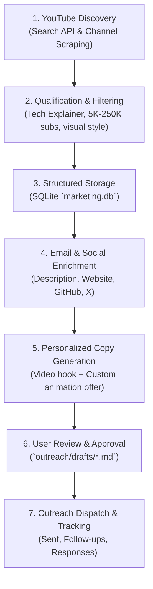

# Project Overview: KlipHowl Outreach & Prospecting Engine

## 1. What is KlipHowl?

**KlipHowl** is an AI-powered SaaS application that turns transcript excerpts or natural-language prompts into short animated video clips (MP4 format).

### Core Product Architecture & Mechanisms (from `../kliphowl`)
- **Repository Location:** Sibling directory at `../kliphowl` (`~/EMY/Code/Web_dev/current_projects/busi/ai-animation-maker/kliphowl`).
- **Core Pipeline:**
  1. **User Input:** A creator provides a script/transcript section or natural-language concept description.
  2. **AI Scene Generation (`@kliphowl/ai`):** A tool-calling AI agent analyzes the transcript, creates semantic visual elements (nodes, boxes, arrows, labels, callouts), arranges layouts, and designs timed animation steps.
  3. **Video Rendering (`@kliphowl/engine`):** Evaluates the scene AST through an Excalimate/vector animation runtime and renders it to MP4 via headless browser/WebCodecs.
  4. **Output:** A clean, downloadable MP4 animation file ready to be dropped into video editing software (Premiere Pro, DaVinci Resolve, Final Cut).
- **Aesthetic:** Excalidraw-style sketch diagrams, dynamic architectural flows, progressive step-by-step visual reveals, clean tech aesthetic.

---

## 2. Why Tech YouTube Explainers? (Target Persona)

Our initial target audience is **Tech YouTube Explainers who use visual diagrams and animations**.

### Who They Are
- Creators who produce educational tech content on YouTube:
  - **System Design & Distributed Systems** (e.g. ByteByteGo-style, microservices, caching, database sharding, load balancing).
  - **Computer Science Fundamentals & Algorithms** (data structures, memory, concurrency, OS concepts).
  - **Software Engineering & Web Architecture** (HTTP lifecycle, Docker/Kubernetes, GraphQL, REST vs gRPC, authentication).
  - **DevOps, Cloud, & Infrastructure** (AWS/GCP architectures, CI/CD pipelines, security).
  - **Programming Language Deep Dives & Frameworks**.

### Their Core Pain Points
1. **Visual Content is Required for Retention:** Tech topics are abstract. Talking-head videos have low retention. Creators *must* visualize concepts to keep viewers engaged.
2. **Animation is Time-Consuming:** Drawing diagrams manually in Excalidraw, Figma, or animating in After Effects, Premiere, or Manim takes **several hours per video** (often 5–15 hours of animation work per 10-minute video).
3. **Expensive Outsourcing:** Hiring freelance motion designers or video editors costs between $50 to $200 per animated clip, which becomes prohibitive for solo creators and mid-sized channels.
4. **Context Switching:** Software engineers want to spend time scripting and teaching, not tweaking keyframes and transition easing curves.

### Why KlipHowl is an Immediate Win for Them
- **"Transcript In → Animation Out":** Creators already write scripts. They can highlight a 20-second paragraph of their script (e.g., "When the client sends a GET request, the API gateway checks the Redis cache first..."), paste it into KlipHowl, and get a rendered MP4 animation illustrating that exact flow in 60 seconds.
- **Ready for Video Editors:** Generates standard MP4 files that slot right onto video tracks in DaVinci Resolve or Premiere.
- **Cost & Speed:** 10x faster and a fraction of the cost of manual animation.

---

## 3. Goals of This Marketing Workspace

The purpose of this repository is to build a high-precision, automated cold outreach machine:

1. **Prospect Discovery:**
   - Use Python scripts and the YouTube Data API v3 to identify relevant tech YouTube channels matching our criteria.
   - Filter by size (5K – 250K subscribers is the ideal sweet spot where creators read their own business inquiries).
   - Verify they produce visual/diagrammatic content.

2. **Data Enrichment & Lead Storage:**
   - Extract channel metadata, subscriber counts, view averages, and business contact emails (from descriptions, channel about links, GitHub, Twitter, personal sites).
   - Store everything in a structured, queryable local SQLite database (`data/marketing.db`).

3. **Personalized Email Generation:**
   - Analyze recent videos and transcripts from the prospect's channel.
   - Craft personalized, non-generic cold emails that reference a specific video and specific diagram concept.
   - Offer concrete value (e.g., custom free sample animation made for their channel or early private beta access).

4. **Campaign Tracking & Review:**
   - Store drafts for user review before sending.
   - Track delivery status, replies, feedback, and conversions.

---

## 4. Key Metrics & Pipeline Stages



---

## 5. Development & Git Conventions

- **Environment & Commands:** Always use `uv` for dependencies and command execution (`uv run marketing ...`, `uv run discover ...`).
- **Commit Attribution:** All git commits must append the co-author trailer:
  ```text
  Co-authored-by: Gemini <176961590+gemini-code-assist[bot]@users.noreply.github.com>
  ```
