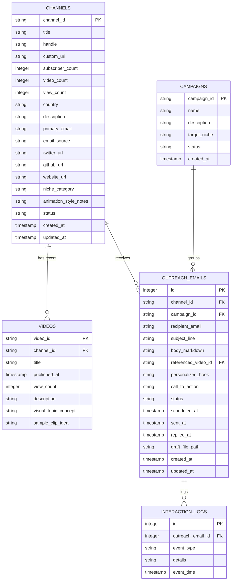

# Storage Plan & Data Architecture

This document defines where and how prospect data, channel metadata, video insights, and personalized cold outreach emails are stored and managed.

---

## 1. Storage Architecture Overview

We adopt a **Dual-Layer Storage Strategy**:

1. **Relational Database (Primary Source of Truth):**
   - Implemented with **SQLite 3** at `data/marketing.db`.
   - **Why SQLite?**
     - Single local file, zero server setup, zero Docker overhead.
     - Built into Python standard library (`import sqlite3`) — zero external runtime dependency.
     - Enforces referential integrity (foreign keys between channels, videos, campaigns, and email drafts).
     - Allows fast, robust SQL queries, deduplication, filtering, and state transitions.

2. **Human-Reviewable File System Layer:**
   - **Markdown Email Drafts (`outreach/drafts/{channel_slug}.md`):** Agents generate complete email drafts as clean markdown files. The human operator can open, read, edit, or copy them directly.
   - **CSV / JSON Exports (`data/exports/`):** Quick exports for viewing in Excel, Google Sheets, or Notion.

---

## 2. Directory Structure

```text
marketing/
├── data/
│   ├── marketing.db            # SQLite database file (gitignored if containing private leads)
│   ├── schema.sql              # Initial DDL migration script
│   └── exports/                # Export snapshots
│       ├── prospects.csv
│       └── prospects.json
│
└── outreach/
    ├── templates/              # Base email frameworks (e.g., pain_point.md, sample_clip.md)
    │   ├── system_design_offer.md
    │   ├── pain_point_animation.md
    │   └── quick_feedback.md
    │
    ├── drafts/                 # Individual generated outreach emails awaiting review
    │   ├── bytebytego_outreach.md
    │   └── hussein_nasser_outreach.md
    │
    └── sent/                   # Historical record of approved & dispatched emails
        └── 2026-11/
```

---

## 3. Relational Database Schema (`data/marketing.db`)



---

## 4. SQL Table Definitions (`schema.sql`)

```sql
-- 1. Channels / Prospects
CREATE TABLE IF NOT EXISTS channels (
    channel_id TEXT PRIMARY KEY,               -- YouTube Channel ID (e.g. UC_x5XG1OV2P6uZZ5FSM9Ttw)
    title TEXT NOT NULL,                       -- Channel Display Name
    handle TEXT,                               -- e.g. @bytebytego
    custom_url TEXT,                           -- Full YouTube URL
    subscriber_count INTEGER DEFAULT 0,
    video_count INTEGER DEFAULT 0,
    view_count INTEGER DEFAULT 0,
    country TEXT,
    description TEXT,
    primary_email TEXT,                        -- Target business email address
    email_source TEXT,                         -- 'yt_description', 'about_page', 'github', 'twitter', 'website'
    twitter_url TEXT,
    github_url TEXT,
    website_url TEXT,
    niche_category TEXT,                       -- 'system_design', 'devops', 'web_dev', 'algorithms', etc.
    animation_style_notes TEXT,                -- 'excalidraw sketches', 'manim animations', 'slides', etc.
    status TEXT DEFAULT 'discovered',          -- 'discovered', 'qualified', 'disqualified', 'in_outreach', 'responded', 'customer'
    qualification_notes TEXT,                  -- Reason for acceptance/rejection
    created_at TIMESTAMP DEFAULT CURRENT_TIMESTAMP,
    updated_at TIMESTAMP DEFAULT CURRENT_TIMESTAMP
);

-- 2. Videos (To provide context for personalization)
CREATE TABLE IF NOT EXISTS videos (
    video_id TEXT PRIMARY KEY,                 -- YouTube Video ID
    channel_id TEXT NOT NULL,
    title TEXT NOT NULL,
    published_at TIMESTAMP,
    view_count INTEGER DEFAULT 0,
    description TEXT,
    visual_topic_concept TEXT,                 -- e.g. "Explains Redis Pub/Sub with box diagrams"
    sample_clip_idea TEXT,                     -- Idea for what KlipHowl could animate for them
    created_at TIMESTAMP DEFAULT CURRENT_TIMESTAMP,
    FOREIGN KEY (channel_id) REFERENCES channels (channel_id) ON DELETE CASCADE
);

-- 3. Outreach Campaigns
CREATE TABLE IF NOT EXISTS campaigns (
    campaign_id TEXT PRIMARY KEY,              -- e.g. 'camp_system_design_nov2026'
    name TEXT NOT NULL,
    description TEXT,
    target_niche TEXT,
    status TEXT DEFAULT 'active',              -- 'draft', 'active', 'completed', 'paused'
    created_at TIMESTAMP DEFAULT CURRENT_TIMESTAMP
);

-- 4. Outreach Emails (Drafts and Sent Messages)
CREATE TABLE IF NOT EXISTS outreach_emails (
    id INTEGER PRIMARY KEY AUTOINCREMENT,
    channel_id TEXT NOT NULL,
    campaign_id TEXT,
    recipient_email TEXT NOT NULL,
    subject_line TEXT NOT NULL,
    body_markdown TEXT NOT NULL,
    referenced_video_id TEXT,
    personalized_hook TEXT,
    call_to_action TEXT,
    status TEXT DEFAULT 'draft',               -- 'draft', 'ready_for_review', 'approved', 'sent', 'replied', 'bounced', 'opted_out'
    draft_file_path TEXT,                      -- e.g. 'outreach/drafts/bytebytego.md'
    sent_at TIMESTAMP,
    replied_at TIMESTAMP,
    notes TEXT,
    created_at TIMESTAMP DEFAULT CURRENT_TIMESTAMP,
    updated_at TIMESTAMP DEFAULT CURRENT_TIMESTAMP,
    FOREIGN KEY (channel_id) REFERENCES channels (channel_id) ON DELETE CASCADE,
    FOREIGN KEY (campaign_id) REFERENCES campaigns (campaign_id) ON DELETE SET NULL,
    FOREIGN KEY (referenced_video_id) REFERENCES videos (video_id) ON DELETE SET NULL
);

-- 5. Interaction / Activity Logs
CREATE TABLE IF NOT EXISTS interaction_logs (
    id INTEGER PRIMARY KEY AUTOINCREMENT,
    outreach_email_id INTEGER NOT NULL,
    event_type TEXT NOT NULL,                  -- 'draft_created', 'edited', 'sent', 'reply_received', 'follow_up_scheduled'
    details TEXT,
    event_time TIMESTAMP DEFAULT CURRENT_TIMESTAMP,
    FOREIGN KEY (outreach_email_id) REFERENCES outreach_emails (id) ON DELETE CASCADE
);

-- Indexes for fast query and filtering
CREATE INDEX IF NOT EXISTS idx_channels_status ON channels(status);
CREATE INDEX IF NOT EXISTS idx_channels_email ON channels(primary_email);
CREATE INDEX IF NOT EXISTS idx_emails_status ON outreach_emails(status);
CREATE INDEX IF NOT EXISTS idx_videos_channel ON videos(channel_id);
```

---

## 5. Prospect Status Lifecycle

```
[Discovered]
     │
     ▼
[Qualified] ──── (Lacks visual content or out-of-scope) ───▶ [Disqualified]
     │
     ▼
[Drafting Email]
     │
     ▼
[Ready for Review] (Markdown written to outreach/drafts/)
     │
     ▼
[Approved & Sent]
     │
     ├───▶ [Replied: Interested] ───▶ [Free Custom Clip Demo / Beta Onboarding]
     ├───▶ [Replied: Not Interested / Opt-Out]
     └───▶ [No Reply after 4 days] ───▶ [Follow-Up Draft]
```

---

## 6. Draft File Format (`outreach/drafts/{slug}.md`)

Each email generated by our pipeline is saved as an individual markdown file with frontmatter for easy review:

```markdown
---
channel_id: "UC_x5XG1OV2P6uZZ5FSM9Ttw"
channel_title: "ByteByteGo"
recipient_name: "Alex"
recipient_email: "alex@example.com"
campaign: "camp_system_design_nov2026"
referenced_video: "How Discord Scaled to 11 Million Users"
status: "ready_for_review"
date_generated: "2026-10-30"
---

### Subject:
Quick question on your Discord architecture animation

### Body:
Hi Alex,

Loved your breakdown on how Discord migrated from Cassandra to ScyllaDB. The visual diagram showing data partitioning at 03:45 made the concept click immediately.

I noticed you use a lot of Excalidraw-style sketch diagrams to explain architectures. They're super engaging, but I know how painful it is to hand-draw and animate every node and arrow.

We built **KlipHowl** (an AI tool where you paste a paragraph of your script/transcript and it outputs a rendered animated MP4 diagram in that clean tech sketch style).

I actually put together a 15-second sample animation of your partition routing explanation:
[Link to 15s MP4 Demo / Unlisted Preview]

Would you be open to using KlipHowl for a clip in your next video? Happy to give you free early access.

Best,
Arif
Founder, KlipHowl
```
