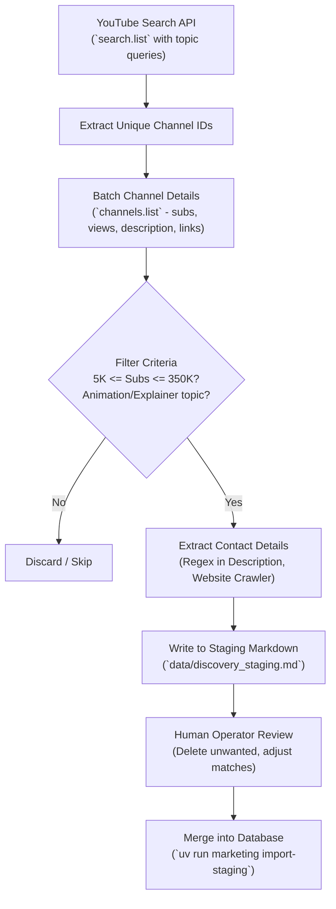

# YouTube Discovery & Scraping Plan

This document details the strategy, technical workflow, and qualification criteria for finding Tech YouTube Explainer channels using the YouTube Data API v3 and enrichment techniques.

---

## 1. Ideal Prospect Profile (ICP)

| Attribute | Target Criteria | Why |
| :--- | :--- | :--- |
| **Niche** | Tech / Software Engineering / System Design / DevOps / CS Explainers | High density of abstract concepts requiring visual diagrams. |
| **Subscriber Count** | **5,000 to 250,000 subscribers** | **Sweet Spot:** Large enough to care deeply about retention and visual polish; small enough that the creator personally monitors their business email. Channels >500k often have agency gates. |
| **Content Style** | Educational, conceptual breakdowns using Excalidraw, Figma, slides, or animations | Direct fit for KlipHowl's animated sketch output. |
| **Activity** | Uploaded at least 1 video in the last 60–90 days | Ensures channel is active and creator is actively producing new scripts. |
| **Language** | English (initially) | Matches KlipHowl's primary prompt and transcript engine. |

---

## 2. YouTube Data API v3 Query Strategy

The YouTube Data API provides 10,000 free quota units per day. We must optimize our search budget:
- `search().list` costs **100 units** per call (returns 50 results).
- `channels().list` costs **1 unit** per call (can batch up to 50 channel IDs).
- `videos().list` costs **1 unit** per call (can batch up to 50 video IDs).

### Keyword Clusters

We run targeted queries that identify creators who teach concepts visually:

```python
QUERY_CLUSTERS = {
    "system_design": [
        "system design animated",
        "system design interview explained",
        "microservices architecture visual guide",
        "how redis works animated",
        "database sharding explained",
        "kafka explained visually",
    ],
    "cs_fundamentals": [
        "data structures animated",
        "algorithms visually explained",
        "how memory works computer science",
        "concurrency vs parallelism animation",
    ],
    "web_dev_and_cloud": [
        "how the web works visual",
        "http protocol explained animation",
        "docker container architecture explained",
        "kubernetes architecture visual",
        "graphql vs rest api explained",
    ],
    "devops_and_security": [
        "ci cd pipeline explained visually",
        "oauth2 explained step by step",
        "jwt authentication flow animation",
    ]
}
```

---

## 3. Discovery Pipeline Architecture



---

## 4. Email Extraction & Enrichment Techniques

Because YouTube gates the "View Email Address" button behind an interactive reCAPTCHA on the web UI, automated email extraction follows a multi-tier fallback:

### Tier 1: Channel Description Regex Parsing
Many tech creators put their contact email directly in their channel bio/description (e.g., `For business inquiries: name@domain.com` or `Email: ...`).
- Regex pattern detects standard email addresses while filtering out common generic false positives (e.g. `support@youtube.com`).

### Tier 2: Channel External Links & Socials
The YouTube Channel `brandingSettings` or About page contains links to:
- **Personal Websites / Portfolios:** Scrape the homepage, `/about`, or `/contact` for `mailto:` links or contact addresses.
- **GitHub Profiles:** Many tech YouTubers link their GitHub. GitHub public profile metadata or public commit logs (`https://api.github.com/users/{username}/events/public`) frequently expose creator email addresses.
- **Twitter / X / Substack:** Check bio descriptions.

### Tier 3: Human Verification Queue
For high-value qualified channels (e.g., 50k subs, perfect KlipHowl fit) where no email was discovered automatically:
- Flag the channel in SQLite as `needs_manual_email`.
- Provide a quick CLI command or script that opens their YouTube About page in the browser for a 5-second human captcha solve.

---

## 5. Execution Commands (using `uv`)

```bash
# Run automated YouTube discovery (stages into data/discovery_staging.md)
uv run discover

# Search a specific custom keyword query
uv run discover --query "microservices architecture visual guide"

# Or via marketing CLI
uv run marketing discover --queries 2

# After reviewing data/discovery_staging.md and deleting unwanted channels:
uv run marketing import-staging
```
